# Part 1

## General question

How do we know whether a model has learned something useful that will work on new data?

## General idea {.smaller}

Machine learning uses data to *learn* relationships between:

> Features (X): available information

> Outcome (Y): what we want to predict

. . .

Examples:

| Features | Outcome |
|------------------------------------|------------------------------------|
| Childrens' age, smartphone ownership, etc | Hours of sleep |
| Area, Perimeter, MajorAxisLength, MinorAxisLength, Compactness | Type of bean |
| Pixel values | Digit (0–9) |

. . .

Goal:

> Accurate predictions for new observations.

## Underfitting and overfitting

```{r}
library(tidyverse)
library(patchwork)

set.seed(123)

n <- 30

x <- sort(runif(n, -3, 3))

# Strong nonlinear signal
y_true <- 4 - x^2

# Add noise
y <- y_true + rnorm(n, sd = 0.7)

df <- tibble(x, y)

# Models
fit_under <- lm(y ~ x, data = df)
fit_good  <- lm(y ~ poly(x, 2, raw = TRUE), data = df)

# Interpolation spline (passes through every point)
fit_over <- splinefun(x, y, method = "periodic")

grid <- tibble(
  x = seq(min(x), max(x), length.out = 1000)
)

grid <- grid %>%
  mutate(
    under = predict(fit_under, .),
    good  = predict(fit_good, .),
    over  = fit_over(x),
    truth = 4 - x^2
  )


theme_my <- theme_minimal(base_size = 13)

p1 <- ggplot(df, aes(x, y)) +
  geom_point(size = 3) + ylim(c(-1,6)) + 
  geom_line(data = grid, aes(y = under),
            colour = "firebrick", linewidth = 1.2) 
  

 p2 <- ggplot(df, aes(x, y)) +
    geom_point(size = 3) + ylim(c(-1,6)) + 
   geom_line(data = grid, aes(y = good),
            colour = "forestgreen", linewidth = 1.2) 
 

p3 <- ggplot(df, aes(x, y)) +
  geom_point(size = 3) + ylim(c(-1,6)) + 
  geom_line(data = grid, aes(y = over),
            colour = "steelblue", linewidth = 1.2) 


```

```{r}
#| echo: false
#| fig-width: 12
#| fig-height: 4

p1 | p2 | p3
```

. . .

-   The model should capture the important characteristics of the data
-   The model should generalize to similar data

<!-- Some groups saw overfitting on the MNIST data last week, was not the best model in the validation set -->

## Sample splitting


## Sample splitting

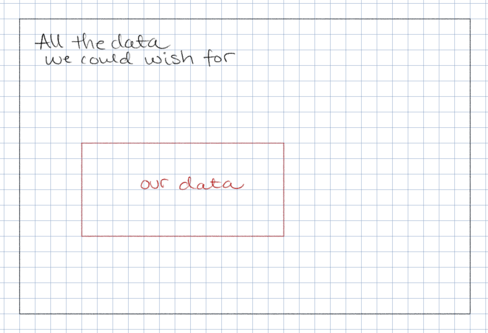

## Sample splitting

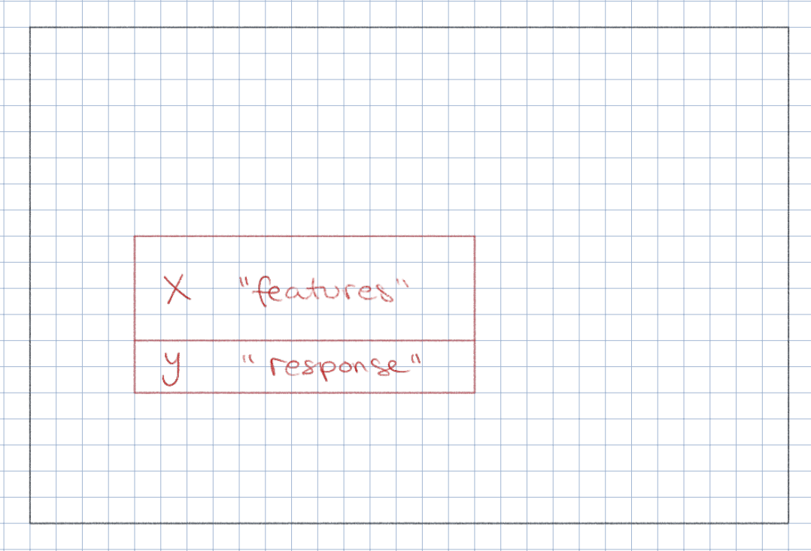

## Sample splitting

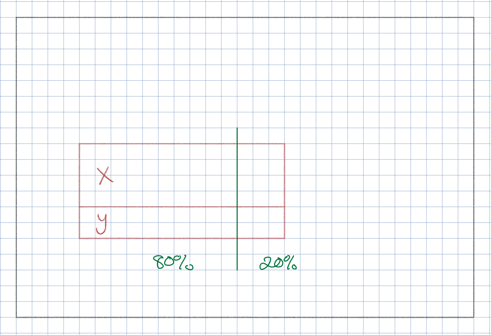

## Sample splitting

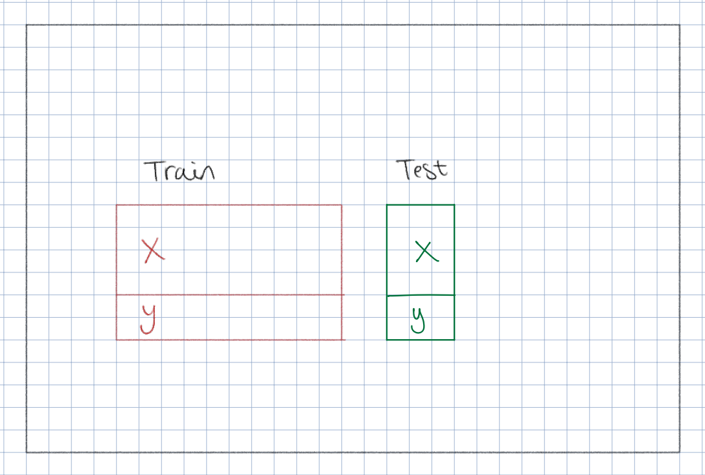

## Sample splitting

## Sample splitting

When we split the data, should we split randomly?

. . .

**MNIST:** Similar frequencies of digits in each split

. . .

**Rare event prediction**: Predict a rare event, P(event) = 0.1

-   Random sampling may give no events in one set

. . .

-   Split e.g. so that both training and test contains 10% events

## Sample splitting

When we split the data, should we split randomly?

**MNIST:** Similar frequencies of digits in each split

**Rare event prediction**: Predict a rare event, P(event) = 0.1

**Grouped observations**: Multiple observations per person in the data, predict on new persons

. . .

-   Random splitting may give observations from one person in both training and test

. . .

-   "Data leakage": We use information that would not be available when making predictions. Leads to overly optimistic estimates of model performance.

## Sample splitting: What is that we want to evaluate on the test set?

. . .

$$ 
\text{accuracy} = \frac{\text{number of correct predictions}}{\text{total number of predictions}}
$$

. . .

**TASK 1A**: We aim to predict an event

1.  If P(event) = 0.5 and we always predict "no event", what will our accuracy be?
2.  If P(event) = 0.05 and we always predict "no event", what will our accuracy be?

## Sample splitting: What is that we want to evaluate on the test set?

. . .

$$ 
\text{accuracy} = \frac{\text{number of correct predictions}}{\text{total number of predictions}}
$$

. . .

Example: We predict an event: 0 = no event, 1 = event

1.  If P(event) = 0.5 and we always predict "no event", what will our accuracy be?

> Ans: We will be correct 50% of the time, so accuracy = 0.5

2.  If P(event) = 0.05 and we always predict "no event", what will our accuracy be?

> Ans: We will be correct 05% of the time, so accuracy = 0.95

. . .

Accuracy depends on the class probabilities, and even a trivial classifier can achieve high accuracy on imbalanced data.

## Confusion matrix

|   | **Predicted positive** | **Predicted negative** |
|:--------------------|:------------------------:|:------------------------:|
| **Actual positive** | [**True Positive (TP)**]{style="color: #21803a;"} | [**False Negative (FN)**]{style="color: #c0392b;"} |
| **Actual negative** | [**False Positive (FP)**]{style="color: #c0392b;"} | [**True Negative (TN)**]{style="color: #21803a;"} |

. . .

-   **TP:** Correctly predicted positive
-   **TN:** Correctly predicted negative
-   **FP:** Incorrectly predicted positive (*false alarm*)
-   **FN:** Incorrectly predicted negative (*missed case*)

## Classification metrics

|   | **Predicted positive** | **Predicted negative** |
|:--------------------|:------------------------:|:------------------------:|
| **Actual positive** | [**True Positive (TP)**]{style="color: #21803a;"} | [**False Negative (FN)**]{style="color: #c0392b;"} |
| **Actual negative** | [**False Positive (FP)**]{style="color: #c0392b;"} | [**True Negative (TN)**]{style="color: #21803a;"} |

**Accuracy:** How often is the model correct?

$$
\text{Accuracy} = \frac{TP+TN}{TP+TN+FP+FN}
$$

<!-- ## Classification metrics -->

<!-- | | **Predicted positive** | **Predicted negative** | -->

<!-- |:---|:---:|:---:| -->

<!-- | **Actual positive** | <span style="color: #21803a;">**True Positive (TP)**</span> | <span style="color: #c0392b;">**False Negative (FN)**</span> | -->

<!-- | **Actual negative** | <span style="color: #c0392b;">**False Positive (FP)**</span> | <span style="color: #21803a;">**True Negative (TN)**</span> | -->

<!-- **Precision:** Of all predicted positives, how many were correct? -->

<!-- $$ -->

<!-- \text{Precision} = \frac{TP}{TP+FP} -->

<!-- $$ -->

<!-- . . .  -->

<!-- High precision is important when false positives (incorrectly predicted positive cases) are particularly costly. -->

<!-- Spam detection: An important email is incorrectly classified as spam, causing the recipient to miss critical information. -->

<!-- Trade-off: Increasing precision *could* mean accepting more false negatives -->

<!-- ## Classification metrics -->

<!-- | | **Predicted positive** | **Predicted negative** | -->

<!-- |:---|:---:|:---:| -->

<!-- | **Actual positive** | <span style="color: #21803a;">**True Positive (TP)**</span> | <span style="color: #c0392b;">**False Negative (FN)**</span> | -->

<!-- | **Actual negative** | <span style="color: #c0392b;">**False Positive (FP)**</span> | <span style="color: #21803a;">**True Negative (TN)**</span> | -->

<!-- **Recall (sensitivity):** Of all actual positives, how many were identified? -->

<!-- $$ -->

<!-- \text{Recall} = \frac{TP}{TP+FN} -->

<!-- $$ -->

<!-- . . .  -->

<!-- When do we care about recall / sensitivity? -->

<!-- . . .  -->

<!--   - Cancer screening: We want to identify as many patients with cancer as possible. A false negative is a critical mistake. -->

<!-- ## Classification metrics -->

<!-- | | **Predicted positive** | **Predicted negative** | -->

<!-- |:---|:---:|:---:| -->

<!-- | **Actual positive** | <span style="color: #21803a;">**True Positive (TP)**</span> | <span style="color: #c0392b;">**False Negative (FN)**</span> | -->

<!-- | **Actual negative** | <span style="color: #c0392b;">**False Positive (FP)**</span> | <span style="color: #21803a;">**True Negative (TN)**</span> | -->

<!-- **Recall (sensitivity):** Of all actual positives, how many were identified? -->

<!-- $$ -->

<!-- \text{Recall} = \frac{TP}{TP+FN} -->

<!-- $$ -->

<!-- **Specificity:** Of all actual negatives, how many were identified? -->

<!-- $$ -->

<!-- \text{Specificity} = \frac{TN}{FP+TN} -->

<!-- $$ -->

## Classification metrics

| Metric | Question |
|--------------------------------|----------------------------------------|
| **Accuracy** | Of all predictions, how many were correct? |
| **Sensitivity / Recall / True positive rate** | Of the actual positives, how many did we identify? |
| **Specificity / True negative rate** | Of the actual negatives, how many did we identify? |
| **Precision** | Of the predicted positives, how many were actually positive? |
|  |  |

**TASK 1B:** Find the formulas, using the confusion matrix, for accuracy, recall, specificity and precision.

## Classification metrics {.smaller}

|   | **Predicted positive** | **Predicted negative** |
|:--------------------|:------------------------:|:------------------------:|
| **Actual positive** | [**True Positive (TP)**]{style="color: #21803a;"} | [**False Negative (FN)**]{style="color: #c0392b;"} |
| **Actual negative** | [**False Positive (FP)**]{style="color: #c0392b;"} | [**True Negative (TN)**]{style="color: #21803a;"} |

$$
\text{Accuracy} = \frac{TP+TN}{TP+TN+FP+FN}
$$

$$
\text{Sensitivity} = \frac{TP}{TP+FN}
$$

$$
\text{Specificity} = \frac{TN}{FP+TN}
$$

$$
\text{Precision} = \frac{TP}{TP+FP}
$$

## Classification metrics

*Note:* Often these metrics will depend on a **threshold** that we choose.

. . .

**Prediction task:** Will a person commit another crime within 2 years? Yes / No.

. . .

**Probabilistic prediction** (e.g. random forest, neural network): Model outputs class probabilities: *P(Yes)*

-   For **threshold** *k*: Predict "Yes" if *P(Yes)* \> *k*.

. . .

Our choice of **threshold** *k* will affect the different metrics in some way.

## Probabilistic predictions: ROC-space

ROC space = Receiver Operating Characteristic space

-   X-axis: False positive rate = 1 - specificity
-   Y-axis: True positive rate = sensitivity = recall

> By plotting different models' metrics in the ROC space, we can do model comparison

## Probabilistic predictions: ROC-space

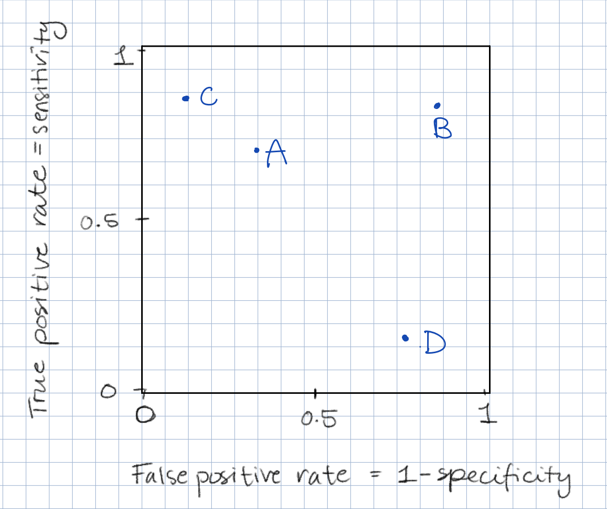

**TASK 1C:** Which of the four classification models A, B, C or D is best?

## Probabilistic predictions, ROC-curves {.smaller}

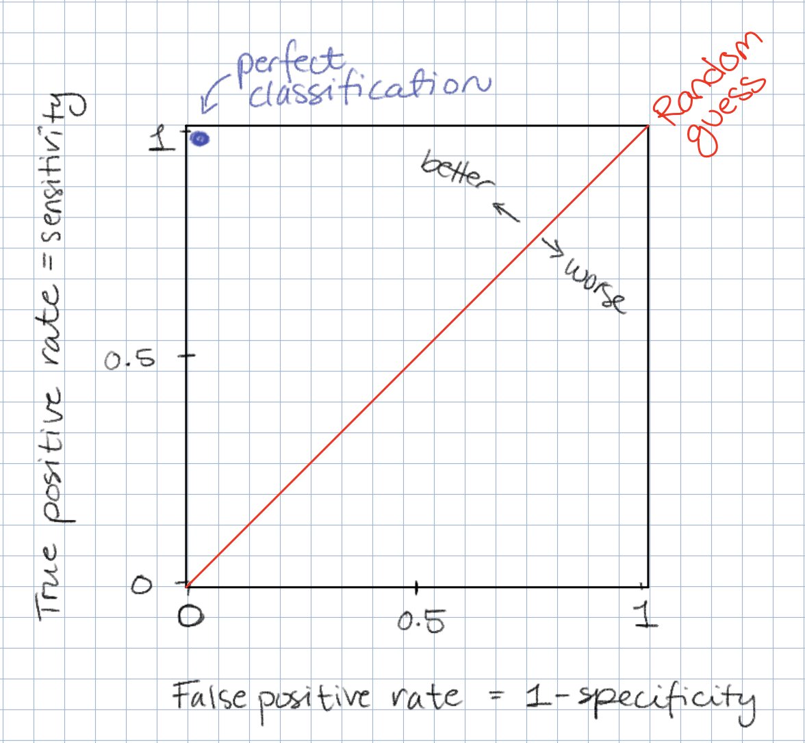

. . .

> By plotting a probabilistic prediction models' metrics in the ROC space for all values of a threshold *k* we get a curve

## Probabilistic predictions, ROC-curves {.smaller}

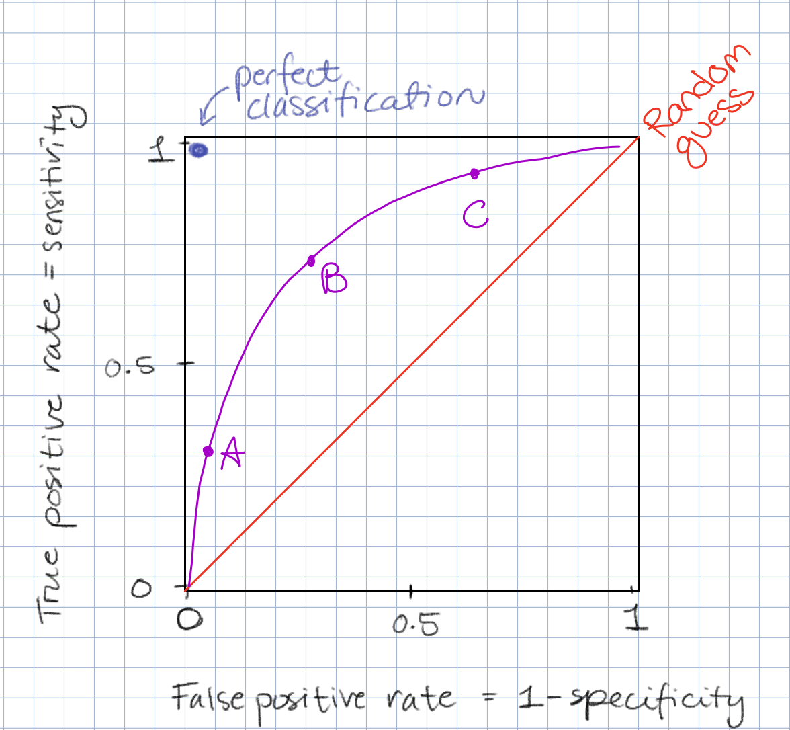

**TASK 1D:** What are the benefits of choosing thresholds corresponding to A, B or C?

## Probabilistic predictions, ROC-curves

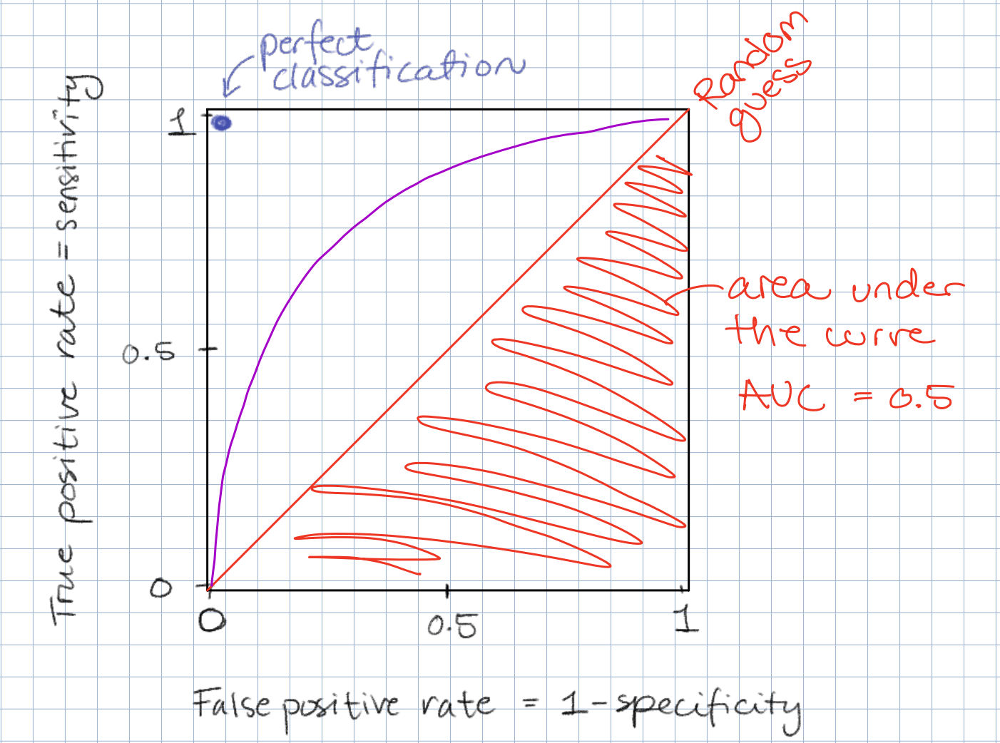

## Probabilistic predictions, ROC-curves {.smaller}

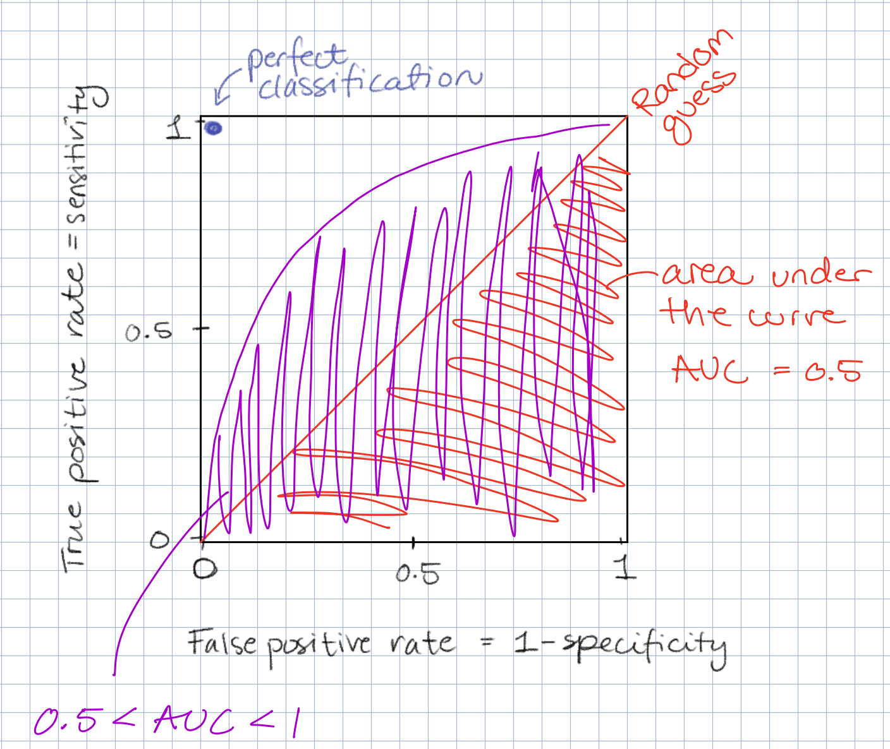

Given a true positive (person did commit a new crime) and a true negative (person did not commit a new crime), the purple model is better than a random guess at *discriminating* between these two classes.

## Probabilistic predictions {.smaller}

But again: trouble arises with rare classes

. . .

**Rare event prediction**: Out of 10,000 people, 100 have the disease and 9,900 do not (prevalence = 1 %).

Confusion matrix:

|                 | **Predicted disease** | **Predicted no disease** |
|:----------------|:---------------------:|:------------------------:|
| **Has disease** |          90           |           495            |
| **No disease**  |          10           |           9405           |

**Task 1E:**

1.  Calculate the true positive rate (sensitivity, recall) and the false positive rate (1 - specificity).

2.  Place the model in ROC-space, does it look good?

3.  Calculate the *precision* of the model: of all predicted positives, how many were correct?

## Probabilistic predictions {.smaller}

ROC-curve: True positive rate (sensitivity, recall) vs false positive rate (1 - specificity)

PR-curve: **P**recision vs **R**ecall

Both ROC and PR curves are constructed by varying the classification threshold.

| ROC curve | PR curve |
|------------------------------------|------------------------------------|
| x-axis: False positive rate | x-axis: Recall |
| y-axis: True positive rate (recall) | y-axis: Precision |
| Shows discrimination between classes | Shows the trade-off between recall and precision |
| Random baseline: diagonal (AUC = 0.5) | Random baseline: prevalence of positive class (e.g. 1%) |
|   |   |

::: fragment
PR curves are particularly informative when the positive class is rare and we care about the reliability of positive predictions. —\> You will see more of them on Friday
:::

## Science practice


# Part 2

## Machine learning and "black boxes" {.smaller}

-   **Linear and logistic regression:**
    -   We specify a mathematical relationship between the features and the response.
    -   Model coefficients can often be interpreted directly.
    -   Complex nonlinear relationships and interactions may be difficult to specify and interpret.
-   **Machine learning models (e.g., random forests and neural networks):**
    -   Can learn complex, nonlinear relationships and interactions from data.
    -   The fitted relationship between features and predictions is often difficult to interpret directly.
    -   Often described as **"black-box" models**.

## Machine learning and "black boxes" {.smaller}

**EU's Ethics guidelines for trustworthy AI (2019)**

AI systems should respect ethical principles:

-   **Human autonomy** – humans should remain in control.
-   **Prevention of harm** – AI should not cause harm.
-   **Fairness** – avoid discrimination and unfair outcomes.
-   **Explicability** – decisions should be understandable and explainable.

Particular care is needed when AI affects **vulnerable groups** or when there are **power imbalances** (e.g., employers vs employees).

AI can bring substantial benefits, but also pose risks and have negative impacts that are difficult to predict or measure (e.g. on democracy, the rule of law, or on the human mind itself.)

## Case study 1

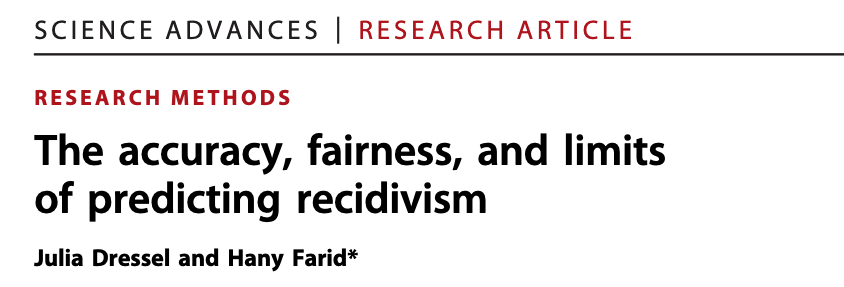

**Recidivism:** relapse into criminal behavior, rearrest, reconviction, or return to prison after serving a prior sentence

## Case study 1 {.smaller}

**Prediction task:** Will a person commit another crime within 2 years? Yes / No

. . .

| Model | Information used | Accuracy |
|------------------------|------------------------|------------------------|
| **COMPAS** (commercial tool) | 137 features; proprietary algorithm | ≈ 65% |
| **Humans** (average of 20 opinions) | 7 features, including age, sex and criminal history | ≈ 67% |
| **Logistic regression** | 2 features: age and number of prior convictions | ≈ 67% |

. . .

**Area under the ROC curve (AUC-ROC):**

-   Humans: 0.71 ± 0.03
-   COMPAS: 0.70 ± 0.04

. . .

> Use ML only when it actually adds value

## Feature importance {.smaller}

> For now: Lets assume a ML model was actually much better than humans or logistic regression to predict recidivism

. . .

Recall EU Ethics guidelines:

-   **Human autonomy** – humans should remain in control.
-   **Prevention of harm** – AI should not cause harm.
-   **Fairness** – avoid discrimination and unfair outcomes.
-   **Explicability** – decisions should be understandable and explainable.

. . .

We would want to know

1.  **Global feature importance**: Which variables are important for the model overall?
2.  **Local feature importance**: For one prediction (one person), which variables contributed and how?

## Feature importance: Global {.smaller}

**Permutation importance**

. . .

Idea: If a feature is important for the model, randomly shuffling its values should make the predictions worse.

. . .

**Example:**

-   Accuracy of recidivism model on test data: **78%**
-   Randomly shuffle *age* in the test data: accuracy drops to **65%**
-   Permutation importance of age: **78 - 65 = 13 percentage points**

. . .

**Caution:** Correlated features complicate interpretation.

-   If age appears unimportant, it may be because other (unshuffled) features contain similar information.

## Feature importance: Global {.smaller}

**Question:** How does a feature (e.g., age) affect the model's predictions?

. . .

**Partial dependence plots (PDP):**

1.  Set everyone's age to 20 → compute the average prediction.
2.  Set everyone's age to 30 → compute the average prediction.
3.  Repeat for different ages and plot the results.

. . .

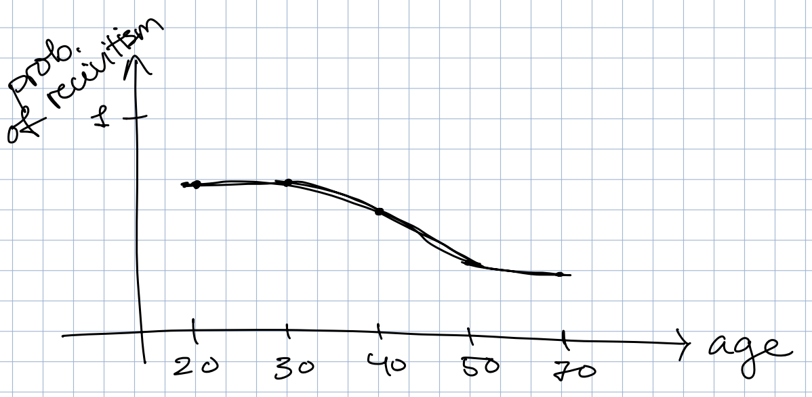

# Feature importance: Global {.smaller}

**Question:** How does a feature (e.g., age) affect the model's predictions?

**Partial dependence plots (PDP):**

1.  Set everyone's age to 20 → compute the average prediction.
2.  Set everyone's age to 30 → compute the average prediction.
3.  Repeat for different ages and plot the results.

**Problem:** We may create unrealistic combinations of features (e.g., a 20-year-old with 30 years of work experience).

. . .

**Accumulated Local Effects (ALE) plots:**

-   Similar purpose, but examine changes in predictions within small intervals of observed feature values.

-   Better suited for correlated features.

## Feature importance: SHAP {.smaller}

```{r}

library(dplyr)
library(ggplot2)

set.seed(123)

n <- 120

# Fake SHAP-like data
df <- bind_rows(
  tibble(
    feature = "Number of prior convictions",
    value = runif(n, 0, 15),
    shap = 0.18 * scale(value)[,1] + rnorm(n, 0, 0.18)
  ),
  tibble(
    feature = "Age",
    value = runif(n, 18, 70),
    shap = -0.22 * scale(value)[,1] + rnorm(n, 0, 0.15)
  ),
  tibble(
    feature = "Juvenile priors",
    value = runif(n, 0, 8),
    shap = 0.14 * scale(value)[,1] + rnorm(n, 0, 0.16)
  ),
  tibble(
    feature = "Charge degree (felony)",
    value = rbinom(n, 1, 0.45),
    shap = 0.10 * value + rnorm(n, 0, 0.12)
  ),
  tibble(
    feature = "Sex (male)",
    value = rbinom(n, 1, 0.75),
    shap = 0.06 * value + rnorm(n, 0, 0.10)
  )
) %>%
  group_by(feature) %>%
  mutate(
    # rescale within feature so colour goes from low (blue) to high (red)
    value_scaled = (value - min(value)) / (max(value) - min(value))
  ) %>%
  ungroup()

# Order features by average absolute SHAP
feature_order <- df %>%
  group_by(feature) %>%
  summarise(mean_abs_shap = mean(abs(shap))) %>%
  arrange(mean_abs_shap) %>%
  pull(feature)

df$feature <- factor(df$feature, levels = feature_order)

p <- ggplot(df, aes(x = shap, y = feature, colour = value_scaled)) +
  geom_vline(xintercept = 0, linetype = "dashed", colour = "grey50") +
  geom_jitter(height = 0.22, width = 0, alpha = 0.8, size = 2) +
  scale_colour_gradient(
    low = "blue",
    high = "red",
    name = "Feature value",
    labels = c("Low", "High"),
    breaks = c(0, 1)
  ) +
  labs(
    title = "Made-up SHAP beeswarm plot: recidivism prediction",
    x = "SHAP value (effect on prediction)",
    y = NULL
  ) +
  theme_minimal(base_size = 14) +
  theme(
    legend.position = "top",
    panel.grid.major.y = element_blank()
  )

p

```

**How to read the beeswarm plot:**

-   **Each dot** represents one person; **each row** represents one feature.
-   **Right** (positive SHAP): higher predicted risk, **Left** (negative SHAP): lower predicted risk.
-   **Colour:** Red = high feature value; blue = low feature value.
-   **Feature order:** Most important features at the top.

## Feature importance: SHAP {.smaller}

```{r}

p

```

**Global interpretation:**

-   The beeswarm plot combines SHAP values from many individuals.

-   Shows which features are important overall and how they contribute to predictions.

## Feature importance: SHAP {.smaller}

```{r}

p

```

**Local interpretation:**

-   Each person has their own SHAP value for every feature.

-   Select one person and examine their SHAP values across all features.

-   Explains why the model's prediction for this person differs from the baseline prediction.

## Science practice


