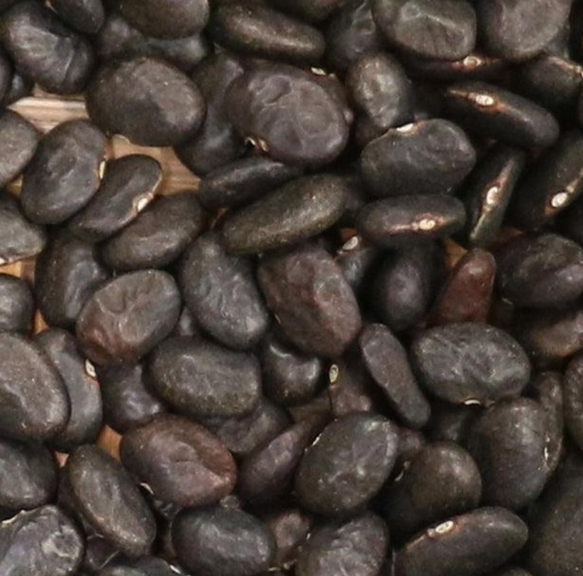
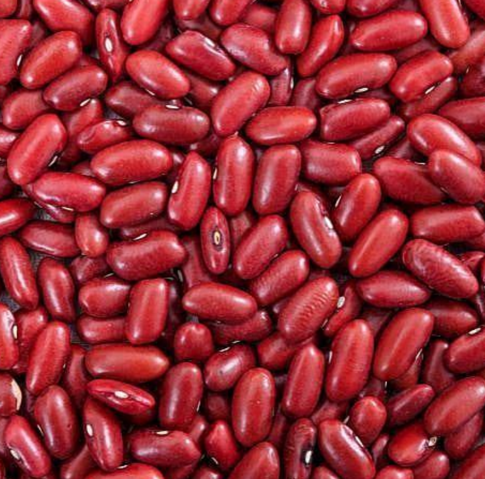
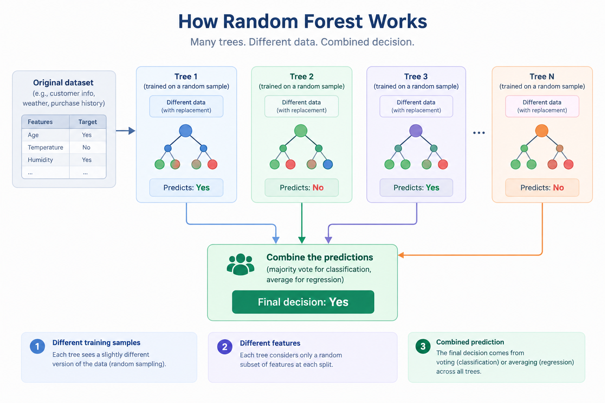

## Instructions for today

- Log into Canvas
- Click on **People** on the right side of the page
- Click on **Group**
- Scroll to the group with the number on your desk and enroll yourself in the group (Tree based methods)
- Download the python code and upload it into Jupiter Hub

## Time table {.smaller}

| Week | Date | Planned Activity | Delivery |
|-----------------|:----------------|----------------:|:-------------------:|
|  | ~~*Fri 09.10*~~ | ~~Presentation of projects and new topic: logistic regression~~ | ~~Assignment, 5 points~~ |
| ~~*42*~~ | ~~*Wed 07.10*~~ | ~~Intro to ML~~ | ~~Assignement 5 points~~ |
|  | *Fri 14.10* | Tree based methods | Assignement 5 points |
| *43* | *Wed 21.10* | Neural Networks |  |
|  | *Fri 13.10* |  |  |


## Plan for  today


We are going to learn about trees

- what is a  decision tree 
- how do  trees make predictions
- advantages and disadvantages of trees
- What is the intuition behind random forests
- Compare a single tree with a random forest


## Motivation{.smaller}

Can we predict the type of bean from some measurement?

::: {layout-ncol=3}
{#fig-first}

{#fig-second}

{#fig-third}
:::


Available information:

- Area, Perimeter,  MajorAxisLength,  MinorAxisLength,  Compactness


. . .


[**Group Work:** Run Part 1 of the code and answer to the questions in Part 1 of the handout]{style="color:red;"}


## Motivation{.smaller}

Can we predict the type of bean from some measurement?

::: {layout-ncol=3}
{#fig-first}

{#fig-second}

{#fig-third}
:::

**Goal** Predict the class of beans from some measurement.

This is a **classification** problem - the respons is categorical and not continuous.


## Classification

We have already seen other techniques to solve this problem

- Regression (yes, it is possible to have regression for multinomial data)

- kNN

. . .

Today we are going to learn about **tree based methods**

## What Is a Decision Tree?

Add FIGURE HERE!!


**Key Idea** The tree repeatedly divides the data into more homogeneous groups.


## How does a tree learn?


1. Take all the (training) data
2. Try different splits
3. For every split measure how different the two groups are
4. Choose the split that most separates the groups
5. Repeat for each group


. . . 

Tree learns by finding the splits that best separate the classes in the training data, using simple and interpretable set fo rules.


## A first, simple tree

[**Group Work** Run the code and answer **Part 2** of the handout]{style="color:red;"}


## Trees - Some vocabulary

IMAGE WITH SPLIT, BRANCHES, LEAVES

## A first, simple tree


IMAGE HERE (Three with one split)


How does a tree makes a prediction in each group? 

A leaf contains training examples that reached that same point in the tree.

- For _classification_ the tree typically predicts the most common class among those examples.

- For _regression_ the tree typically predicts the mean among those examples.


## Interpreting a tree

A tree can be explained as a set of rules.

Example:

> If Area is below a threshold, predict Seker Otherwise predict Bombay

No statistics background is needed.


. . .


:::: {.columns}

::: {.column width="50%"}
**Advantages**
- Easy to explain and interpret

:::

::: {.column width="50%"}
**Disadvantages**
- Usually too simple
:::

::::


## A deeper tree


One parameter of the tree is the `depth`.

Our tree had depth 1, what happens if we allow the tree to grow deeper?

[**Group Work** Run the code and answer to the questions in **Part 3**]{style="color:red;"}


## Logistic regression vs regression trees

We fit two models to a simulated dataset.

1.
$$
\log{\frac{p}{1-p}} = \beta_0 + \beta_1x_1 + \beta_2 x_2
$$
2. 
```{r}
#| echo: false
library(rpart)
library(ggplot2)
library(patchwork)
library(tidyverse)
set.seed(1)

n <- 400

x1 <- runif(n, -3, 3)
x2 <- runif(n, -3, 3)

class <- factor(
  ifelse(x1^2 + x2 + rnorm(n,0,0.5) > 4,
         "A",
         "B")
)

dat <- data.frame(x1, x2, class)

logit_fit = glm(class ~ x1 + x2,
    data = dat,
    family = binomial)

tree_fit = rpart(class ~ x1 + x2,
      data = dat,
      method = "class")

grid = expand.grid(x1 = seq(min(dat$x1), max(dat$x1), length.out = 200),
  x2 = seq(min(dat$x2), max(dat$x2), length.out = 200))

grid$logit_class <- ifelse(
  predict(
  logit_fit,
  newdata = grid,
  type = "response"
) > 0.5,
  "A",
  "B"
)

grid$tree_class <- predict(
  tree_fit,
  newdata = grid,
  type = "class"
)


p1 = grid %>% ggplot() +
  geom_raster(aes(x1, x2, fill = logit_class) )+ 
  labs(
    title = "Logistic Regression",
    fill = "Class"
  ) +
  geom_point(data = dat, aes(x1,x2, color = class)) + 
    geom_point(data = dat, aes(x1,x2), shape = 21 ) + 

  theme_minimal()

p2 =grid %>% ggplot() +
  geom_raster(aes(x1, x2, fill = tree_class) ) + 
  geom_point(data = dat, aes(x1,x2, color = class)) + 
    geom_point(data = dat, aes(x1,x2), shape = 21 ) + 

  labs(
    title = "Classification Tree",
    fill = "Class"
  ) +
  theme_minimal()


library(rpart.plot)

par(mar = c(1, 1, 3, 1))

rpart.plot(
  tree_fit,
  type = 2,
  extra = 104,
  fallen.leaves = TRUE,
  box.palette = "GnBu",
  cex = 0.9,
  tweak = 1.2,
  main = "Classification Tree for Simulated Data"
)
```


##  Logistic regression vs regression trees
Prediction surfaces

```{r}
#| echo = FALSE
p1 + p2 +
  plot_layout(guides = "collect") &
  theme(legend.position = "bottom")


```


## How deep should a tree be?\ Underfitting vs Overfitting.{}

The main parameter to _tune_ is the tree dept.


:::: {.columns}

::: {.column width="50%"}

**Too Shallow**

- Misses patterns
- High bias
- **Underfitting**
:::

::: {.column width="50%"}

**Too Deep**

- Learns noise
- Memorizes training data
- **Overfitting**
:::

::::


Goal - Find a depth that generalizes well.

. . .


[**Group Work** Run the code and answer to the questions in **Part 4**]{style="color:red;"}


##  Decision Tree Summary{.smaller}

:::: {.columns}

::: {.column width="50%"}

**Advantages**

- Easy to interpret

- Easy to visualize

- Require little preprocessing

- Can model nonlinear relationships
:::

::: {.column width="50%"}

**Disdvantages**

- Overfitting: A tree can soon become too complex and learn noise 


- High variance: Small changes in the training data can produce a very different tree


- Greedy decisions: At each split, the tree chooses the best option locally, which may not lead to the best overall tree.


- Limited predictive stability: A single tree may not capture complex patterns reliably, especially when the data is noisy.
:::
::::


## From One Tree to a Forest

To make predictions more stable we can use a random forest

Instead of relying on one tree

- Build hundreds of trees on slightly different datasets

- Combine their predictions

This is a **Random Forest**


##


. . .

[**Group Work** Run the code and answer the questions in **Part 5**]{style="color:red;"}

##  Random Forests


::: {.columns}

::: {.column width="50%"}

**Advantages**


- Better predictive accuracy

- Less overfitting

- More stable than a single tree


:::

::: {.column width="50%"}


**Disadvantages**

- Harder to explain

- Slower

- No simple set of decision rules


:::
:::::


## Tuning parameters in a Random Forest


We consider two important parameters (there are more one could tune)

- `n_estimators`: Number of trees in the forest
- `max_depth`: Maximum depth of each tree


We use 5-fold cross-validation to tune them.

[**Group Work**  Run Part 6 code and answer Question 6.1]{style="color:red;"}


## Evaluating the models on the test set{.smaller}

Part of the data was set apart as _test_ set. 

We want to evaluate the best tree and the best random forest based on two metrics:

- Accuracy
- Confusion Matrix


## Evaluating the models on the test set{.smaller}

Part of the data was set apart as _test_ set. 

We want to evaluate the best tree and the best random forest based on two metrics:

- Accuracy
$$
\text{Accuracy} = \frac{\text{Correct Predictions}}{\text{Total Predictions}}
$$
- Confusion Matrix


## Evaluating the models on the test set{.smaller}

Part of the data was set apart as _test_ set. 

We want to evaluate the best tree and the best random forest based on two metrics:

- Accuracy
$$
\text{Accuracy} = \frac{\text{Correct Predictions}}{\text{Total Predictions}}
$$
- Confusion Matrix


  - **Rows**: Actual class
  - **Columns**: Predicted class
  
  This tells us much more than a single accuracy value


. . .

[**Group work** Run the code and answer to the questions in **Part 7**]{style="color:red;"}


## So...Which Model Would You Choose?

There is rarely one "best" model. The right choice depends on the problem.

If your goal is prediction probably Random Forest!

If your goal is explanation probably Decision Tree!


## Summary


- Decision trees make predictions using simple rules

- Shallow tree underfit and deep trees often overfit

- Cross-validation helps tuning model parameters

- Random forests combine many trees

- Random forests usually improve prediction

- Interpretability and accuracy often compete
